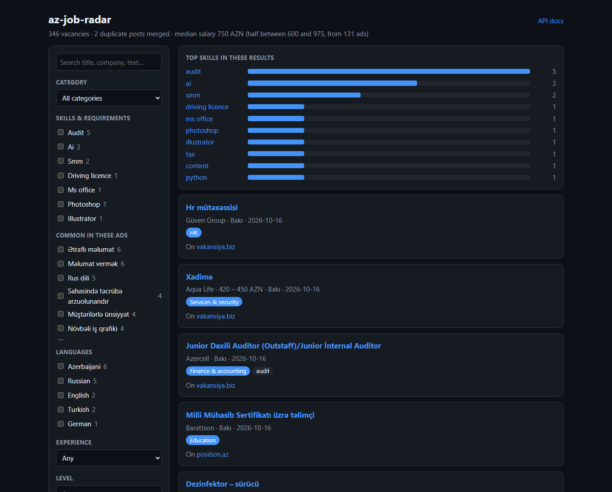
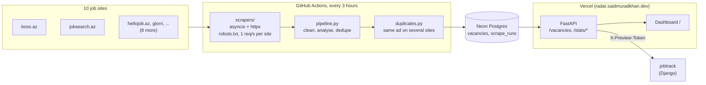
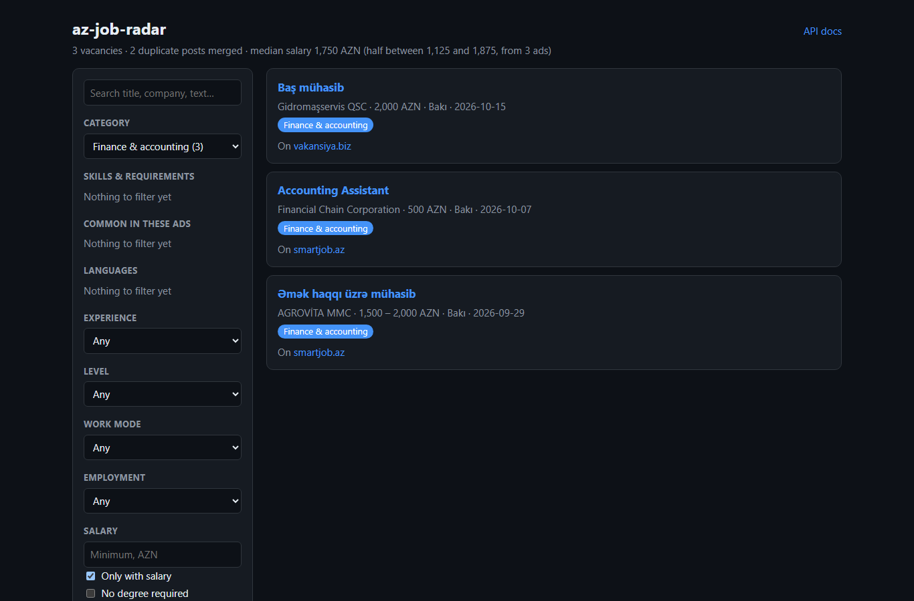

# az-job-radar


Async scraper and data pipeline that collects job vacancies from **10 Azerbaijani job sites**,
reads every ad (category, skills, languages, experience, level, work mode), merges the same ad
posted on several sites, and lets you filter all of it through a FastAPI REST API and a dashboard.

**Live demo:** [radar.saidmuradkhan.dev](https://radar.saidmuradkhan.dev) · [API docs](https://radar.saidmuradkhan.dev/docs) *(private preview, login required for now)*



> Part of a 3-service system: **az-job-radar** (Python) · [cbar-rates](https://github.com/saidmuradkhan/cbar-rates) (Go) · [jobtrack](https://github.com/saidmuradkhan/jobtrack) (Django + React)

## Tech stack

Python 3.12+ · asyncio · httpx · BeautifulSoup · SQLAlchemy · Alembic · PostgreSQL (Neon) · FastAPI · pytest · Ruff · GitHub Actions · Vercel

## Getting started

```bash
python -m venv .venv
.venv\Scripts\activate        # Windows  (Linux/macOS: source .venv/bin/activate)
pip install -e ".[dev]"
pytest --cov
ruff check . && ruff format --check .
```

The tests never touch the internet: every scraper is tested against pages saved in
`tests/fixtures/`. CI fails if coverage drops below 85% (it is at 98%).

Run the web app (dashboard with filters at `/`, JSON at `/vacancies`, API docs at `/docs`).
With `DATABASE_URL` set it reads from the database, otherwise it scrapes the listing pages live:

```bash
uvicorn index:app --reload
```

Scrape all sources and save the results:

```bash
az-job-radar scrape              # listing pages + full text of new ads
az-job-radar scrape --no-details # listing pages only, much faster
az-job-radar reanalyze           # rerun the analysis on stored ads after changing the rules
```

By default the data goes to a local SQLite file, `az_job_radar.db`. Set `DATABASE_URL`
(or pass `--database-url`) to use Postgres; the `psycopg` driver is installed with the package.
The schema is managed with Alembic (`src/az_job_radar/migrations`) and is upgraded automatically
whenever the app or the CLI connects.

## Architecture



The scraper and the website never run in the same process: the cron job writes to Postgres,
the website only reads from it (and keeps the result in memory for 5 minutes). Locally both
use a SQLite file instead.

## Live numbers

From the scheduled scrape on 16 October 2026 (run #34, GitHub Actions):

| | |
|---|---|
| Vacancies read in one run | 926 |
| New since the previous run (3 hours) | 88 |
| Same ad found on another site | 268 |
| Sites that answered | 8 of 10 |

| Site | Ads in the run |
|---|---|
| hellojob.az | 400 |
| boss.az | 158 |
| jobsearch.az | 150 |
| vakansiya.biz | 105 |
| position.az | 86 |
| ishelanlari.az | 28 |
| jobs.glorri.az | 18 |
| smartjob.az, 1is.az | 0 (they block GitHub's servers, work locally) |
| ejob.az | 0 (answers 403 to the scraper since mid-October) |

The log of every run is kept in the `scrape_runs` table and in the
[Scrape workflow](https://github.com/saidmuradkhan/az-job-radar/actions/workflows/scrape.yml).
A source that returns nothing is logged as a warning, so a site that changed its layout is
easy to spot.

## How the data flows

1. **Scrapers** (`scrapers/`) read the listing pages of all ten sites at the same time, one request
   per second per site. For ads the database has not seen yet, they also open the ad itself to get
   the full description (`BaseScraper.detail_url` / `parse_detail`).
2. **Pipeline** (`pipeline.py`) cleans titles (`"TƏCİLİ! Backend developer"` → `"Backend developer"`),
   removes emails and phone numbers from the stored text and runs the analysis.
3. **Analysis** (`analysis.py`) reads the title and the description:
   - category (IT, finance & accounting, sales, HR, healthcare, ...),
   - skills grouped by area: programming languages, frameworks, databases, accounting
     (`1c`, `ifrs`, `tax`, `audit`...), marketing, design, office tools,
   - spoken languages, years of experience, level (intern → lead), remote / hybrid,
     full-time / part-time, whether a degree is required.
4. **Repeated phrases** (`phrases.py`) finds phrases that many ads in the current results share
   (e.g. "kassa əməliyyatlarının aparılması" for accountants), so they can be filtered too.
5. **Duplicates** (`duplicates.py`) groups the same ad posted on different sites: company names are
   normalised (`"PASHA Bank ASC"` = `"Pasha Bank"`), titles are compared by similarity, and ads more
   than 30 days apart are kept separate. The richest copy is shown, with links to the others.
6. **Database** (`db.py`) upserts into `vacancies` (keeping `first_seen_at`, updating `last_seen_at`
   and `duplicate_of`) and logs every run in `scrape_runs`.

## Filters

`GET /vacancies` and the dashboard accept: `q` (text search), `category`, `tag` (repeat for several
skills, all must match), `language`, `phrase`, `seniority`, `work_mode`, `employment_type`,
`max_experience` (years you have), `min_salary`, `salary_only`, `no_degree`, `city`, `source`,
`page`, `per_page`. The response includes `facets`: how many of the matching ads have each value,
so the most common requirements of a category come first.

```
GET /vacancies?category=finance&tag=1c&language=english&max_experience=2
```

## Statistics

Both endpoints accept the same filters as `/vacancies`, so the numbers always describe the
current selection.

- `GET /stats/technologies?group=&top=20`: how many ads ask for each skill, with its group
  (`Programming languages`, `Frameworks`, `Accounting & finance`...) and its share of the ads.
- `GET /stats/salaries`: count, min, quartiles, median and max of monthly salaries, overall,
  per category and per level. A range counts as its middle (`1500 - 2000` → 1750). Only AZN
  salaries of at least 100 are used, so daily rates and other currencies do not skew the numbers.
  Groups with fewer than 3 salaries are left out.

```
GET /stats/technologies?category=it&top=10
GET /stats/salaries?category=finance
```

The dashboard shows the same data: a bar chart of the top skills in the current results (a click
on a bar adds that skill to the filters) and the median salary next to the result count.



*Screenshots are made from the saved test pages in `tests/fixtures/` (listing pages only, so
fewer skills are found than on the live site, where the full text of every ad is read).*

## Deployment

The app runs on Vercel as a single Python function (`index.py`, see `vercel.json`).
Without `DATABASE_URL`, listing pages are scraped on demand and cached in memory for 30 minutes
(no full descriptions, so the analysis only sees titles). With a database, the scheduled
`az-job-radar scrape` fills it and the site reads from there.

While the project is in review, the site is behind a small login page. It is turned on by
environment variables and turned off by removing them:

| Variable | Purpose |
|---|---|
| `PREVIEW_USER`, `PREVIEW_PASSWORD` | Login credentials. If either is missing, the site is public. |
| `PREVIEW_SECRET` | Key for signing the session cookie. Other services can send it as `X-Preview-Token`. |

`/health` is always public.

## Sources

| Site | How | Full text from |
|---|---|---|
| boss.az | Next.js page data, newest 24 per top category | listing page itself |
| jobsearch.az | JSON endpoint the site itself uses | vacancy JSON |
| jobs.glorri.az | Next.js page data, 5 pages | ad page |
| hellojob.az | HTML, 5 pages | ad page |
| smartjob.az | HTML, newest 20 | JobPosting JSON-LD |
| ejob.az | HTML, 5 pages | ad page |
| vakansiya.biz | HTML, 5 pages | JobPosting JSON-LD |
| position.az | HTML, one page | ad page |
| 1is.az | HTML, 3 pages (premium repeats skipped) | ad page |
| ishelanlari.az | HTML, 2 pages | ad page |

The scraper does not try to get around a block: a site that refuses it is skipped.

Checked but not used: busy.az (content only rendered in the browser), projobs.az (empty),
isveren.az (under maintenance), hh API (needs a registered app).

## Roadmap

- [x] Project setup: package layout, `Vacancy` model, tests, CI
- [x] boss.az scraper with an offline fixture
- [x] jobsearch.az scraper (JSON API with pagination)
- [x] Run all sources concurrently with `asyncio.gather`, polite delay between requests
- [x] Respect `robots.txt`
- [x] Normalization: titles, salaries, tech tags (Python, React, Go...)
- [x] Deduplication by `uid`
- [x] Store with SQLAlchemy (SQLite locally, `DATABASE_URL` for Postgres), log scrape runs
- [x] Alembic migrations
- [x] Postgres on Neon
- [x] CLI: `az-job-radar scrape`
- [x] Eight more sources (10 in total), full ad text from detail pages
- [x] Ad analysis: category, skills, languages, experience, level, work mode, degree
- [x] Filters + counts in the API and the dashboard, repeated phrases per category
- [x] Same ad on several sites shown once (cross-site duplicate detection)
- [x] Analytics: most requested technologies, salary ranges
- [x] FastAPI: `/vacancies`, `/vacancies/{uid}` and a dashboard
- [x] Preview deployment on Vercel behind a login page
- [x] FastAPI: `/stats/technologies`, `/stats/salaries`, top skills chart on the dashboard
- [x] Test coverage above 85%, checked in CI, code formatted with Ruff
- [x] README: architecture diagram, live numbers, screenshots
- [ ] Docker + docker-compose
- [x] Scheduled scraping (GitHub Actions cron)

## Ethics

The scraper identifies itself with a clear User-Agent, waits between requests,
respects each site's `robots.txt`, only opens an ad page once, and does not store
emails or phone numbers. Every ad links back to the original site.

## License

MIT
